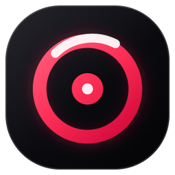
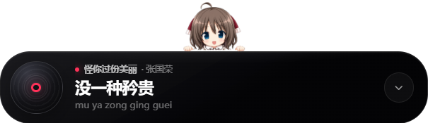
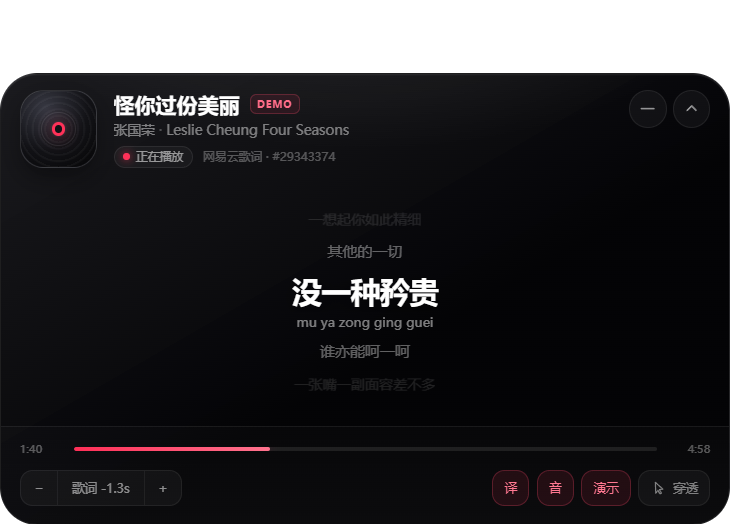
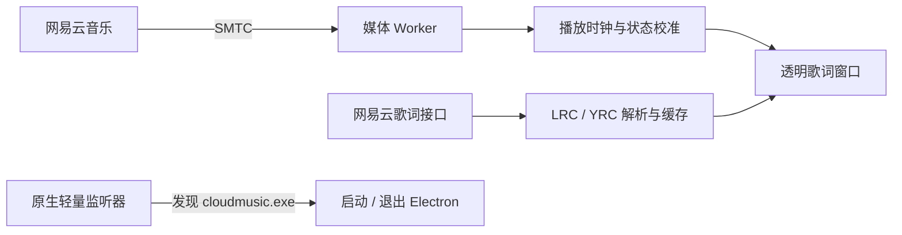

<div align="center">
  
  <h1>云岛歌词</h1>
  <p><strong>给网易云音乐一座轻巧、流畅、始终在线的桌面歌词岛。</strong></p>
  <p>Windows · Electron · SMTC · 水无月萤主题</p>

  <p>
    <a href="https://github.com/Ars1027/netease-island-lyrics/releases/latest"></a>
    <a href="https://github.com/Ars1027/netease-island-lyrics/actions/workflows/ci.yml"></a>
    <a href="https://github.com/Ars1027/netease-island-lyrics/releases"></a>
    
    <a href="LICENSE"></a>
  </p>

  <p>
    <a href="https://github.com/Ars1027/netease-island-lyrics/releases/latest"><strong>下载最新版</strong></a>
    ·
    <a href="#使用方法">使用方法</a>
    ·
    <a href="#常见问题">常见问题</a>
    ·
    <a href="#从源码运行">参与开发</a>
  </p>
</div>

> [!NOTE]
> 当前仓库发布的是水无月萤主题版 `v0.3.4`。应用不会注入或修改网易云音乐，播放信息来自 Windows 系统媒体会话（SMTC）。

## 界面预览

<p align="center">
  
</p>
<p align="center"><sub>紧凑态：人物、封面、歌曲信息、主歌词与副行集中在一枚透明胶囊中。</sub></p>

<details open>
  <summary><strong>展开歌词视图</strong></summary>
  <br>
  <p align="center">
    
  </p>
</details>

## 亮点

| 体验 | 实现 |
| --- | --- |
| 🎵 自动识别 | 读取 `cloudmusic.exe` 的 SMTC 会话，识别歌曲、歌手、封面、进度与播放状态 |
| ✨ 丝滑歌词 | 双层缓冲切句；相邻歌词纵向滑动，seek/切歌交叉淡化，不闪屏 |
| ⏱️ 准确同步 | 单调时钟插值、播放器时间戳校准、350ms 内部提前补偿，并支持 ±5 秒手动偏移 |
| 🈶 多轨歌词 | 支持普通 LRC、YRC、翻译与音译；当前句到点后整句直接高亮 |
| 🏝️ 两种形态 | 紧凑胶囊长期置顶，展开态查看五行歌词、翻译、时间轴和同步设置 |
| 👻 悬停透明 | 紧凑态悬停人物或胶囊任一区域时整体淡至 35%，拖动时自动恢复清晰 |
| 🖱️ 自由交互 | 大面积原生拖动、真实鼠标穿透，`Ctrl + Alt + L` 随时锁定或解锁 |
| 🚀 随网易云启动 | 登录后仅驻留轻量原生监听器；网易云出现时启动云岛，退出后释放 Electron 进程 |
| 🪶 低占用 | 无常驻高刷 JS 循环、封面按事件传输、动画只使用 transform/opacity 合成层 |
| 🖥️ 高刷动画 | 动画由显示器刷新率驱动，在 120/144Hz 屏幕上保持顺滑 |

## 下载与安装

### 系统要求

- Windows 10 1809 或更高版本（仅 x64）
- 网易云音乐能够向 Windows 提供 SMTC 当前播放信息
- 不需要安装 Node.js，不需要管理员权限

### 安装步骤

1. 前往 [Releases](https://github.com/Ars1027/netease-island-lyrics/releases/latest)。
2. 下载 `NeteaseIslandLyrics-0.3.4-portable.exe` 和同名 `.sha256` 文件。
3. 如果旧版本正在运行，请先从托盘菜单选择“退出”，再双击新版本。
4. 打开网易云音乐并播放歌曲，云岛会出现在主屏幕顶部中央。

> [!WARNING]
> 当前个人构建没有商业代码签名证书。Windows 首次运行可能显示“未知发布者”；请先核对下载来源和 SHA-256，再选择“更多信息”→“仍要运行”。portable 首次解压启动可能需要数秒。

验证文件：

```powershell
(Get-FileHash .\NeteaseIslandLyrics-0.3.4-portable.exe -Algorithm SHA256).Hash
```

发布页同时提供校验文件；两个哈希值必须完全一致。

## SMTC 与 BetterNCM

云岛通过 Windows **System Media Transport Controls（SMTC）** 获取当前播放信息，这是识别网易云的必要条件。

- 官方客户端能正常出现在 Windows 媒体控制区域时，通常可直接识别。
- 如果使用 BetterNCM，请安装并启用其 **SMTC** 插件，然后彻底重启网易云音乐。
- 如果云岛一直显示“等待网易云音乐”，先确认 Windows 媒体控制区域能看到当前歌曲，再检查 SMTC 插件。

应用默认只接受网易云会话，避免浏览器或其他播放器抢占歌词岛。

## 使用方法

### 紧凑态

- 封面、标题、歌词和人物区域均可拖动窗口。
- 点击右侧箭头展开完整歌词。
- 鼠标停在人物或胶囊上时，整座岛会柔和淡出；开始拖动后恢复清晰。

### 展开态

- 查看前后五行歌词、翻译/音译与播放时间轴。
- 使用 `− / +` 以 0.1 秒调整歌词；按住 `Shift` 点击以 0.5 秒调整。
- 点击“译”“音”切换副行，点击顶部箭头收起。

### 鼠标穿透与托盘

- `Ctrl + Alt + L`：开启或解除鼠标穿透。
- 托盘菜单：显示/隐藏、紧凑/展开、强制置顶、随网易云自动启动、演示模式和退出。
- 直接双击启动属于手动实例，不会因网易云退出而自动关闭。

## 随网易云自动启动

首次前台运行后，程序会：

1. 将轻量原生监听器安装到当前用户的 `LocalAppData`。
2. 把 Windows 当前用户启动项指向监听器，而不是 Electron 主程序。
3. 检测到 `cloudmusic.exe` 时启动所选 portable；网易云完全退出约 2–5 秒后，受管云岛也完整退出。

关闭托盘中的“随网易云自动启动”会移除启动项并停止监听器。移动 portable 后，手动运行一次新位置即可刷新联动目标。

## 更新与卸载

### 更新

1. 从托盘彻底退出正在运行的旧版本。
2. 下载并启动新版 EXE；原有位置、歌词偏移和显示设置会继续沿用。
3. 前台运行一次后，网易云联动目标会自动更新到新路径。

多个人物版本共享 App ID、设置目录、监听器与单实例锁，不能同时运行。

### 卸载

1. 先在托盘中关闭“随网易云自动启动”。
2. 从托盘选择“退出”，然后删除 portable EXE。
3. 如需同时清除设置和缓存，可删除 `%APPDATA%\Netease Island Lyrics` 与 `%LOCALAPPDATA%\Netease Island Lyrics`。

## 工作原理



- 媒体时间以 Windows 返回的位置和更新时间为锚，播放时平滑插值，暂停时冻结。
- 歌词服务按歌名、歌手和时长综合消歧，并缓存 30 天。
- 普通更新不会重复传输大体积 Base64 封面；切歌或封面变化时才发送。
- 悬停检测只在窗口可见且处于紧凑态时低频运行，隐藏、空闲、展开和退出都会彻底停止。

## 从源码运行

需要 Windows 10 1809+、Node.js 18+。构建原生监听器还需要系统中的 .NET Framework C# 编译器。

```powershell
git clone https://github.com/Ars1027/netease-island-lyrics.git
cd netease-island-lyrics
npm ci
npm test
npm start
```

常用命令：

```powershell
npm run demo      # 不依赖真实歌曲，预览完整交互
npm run probe     # 检查本机 SMTC 会话
npm run watcher   # 重新构建轻量原生监听器
npm run dist      # 构建 Windows x64 portable
```

中国大陆下载 Electron 较慢时，可先设置镜像：

```powershell
$env:ELECTRON_MIRROR = 'https://npmmirror.com/mirrors/electron/'
npm ci
```

提交代码前请先阅读 [CONTRIBUTING.md](CONTRIBUTING.md)，并确保 `npm test` 全部通过。

## 常见问题

<details>
  <summary><strong>一直显示“等待网易云音乐”怎么办？</strong></summary>
  <br>
  云岛必须能读取网易云的 SMTC 会话。请先播放歌曲，确认 Windows 媒体控制区域能显示该歌曲；BetterNCM 用户需要安装并启用 SMTC 插件。完成后彻底退出并重新打开网易云。
</details>

<details>
  <summary><strong>必须安装 BetterNCM 吗？</strong></summary>
  <br>
  不一定。BetterNCM 只是让部分网易云版本提供 SMTC 会话的一种方式；只要网易云已经向 Windows 暴露媒体会话，就可以直接使用。
</details>

<details>
  <summary><strong>双击新版本后看起来还是旧版本？</strong></summary>
  <br>
  应用使用单实例锁。请先在托盘中彻底退出旧版本，再启动新 EXE；仅隐藏窗口不会释放旧进程。
</details>

<details>
  <summary><strong>为什么任务管理器里会出现多个进程？</strong></summary>
  <br>
  这是 Electron 的正常多进程结构，通常包含主进程、渲染进程和 GPU 进程，并不代表应用被重复启动。
</details>

<details>
  <summary><strong>能覆盖全屏游戏吗？</strong></summary>
  <br>
  普通桌面、浏览器、全屏视频和无边框全屏通常可以。绕过 DWM 的独占全屏程序不保证能够覆盖。
</details>

<details>
  <summary><strong>为什么某些歌曲没有歌词或匹配到其他版本？</strong></summary>
  <br>
  网易云网页接口并非公开稳定 API，地区、版权、纯音乐和同名发行版本都可能影响结果。可通过展开态偏移设置修正时间，但无法绕过服务端限制。
</details>

## 隐私与限制

- 不注入、不修改网易云音乐，不读取账号 Cookie。
- 只在本机保存界面设置和歌词缓存，不上传播放历史。
- 歌词请求使用 `music.163.com` 网页接口；该接口可能随时变化。
- 当前仅支持 Windows x64；真正的独占全屏程序可能无法显示桌面叠加层。

## 致谢与许可证

- 网易云歌词字段、歌词类型和解析策略参考 [jitwxs/163MusicLyrics](https://github.com/jitwxs/163MusicLyrics)。
- Windows 当前播放检测使用 [`@coooookies/windows-smtc-monitor`](https://github.com/leaguetavern/node-windows-smtc-monitor)。
- 第三方归属见 [THIRD_PARTY_NOTICES.md](THIRD_PARTY_NOTICES.md)。

源代码采用 [MIT License](LICENSE)。人物主题素材不包含在 MIT 授权中，详细说明见 [ASSETS_LICENSE.md](ASSETS_LICENSE.md)。本项目不是网易云音乐官方产品，与网易公司、BetterNCM 及相关角色作品的权利方不存在隶属、授权或合作关系；相关名称、角色与商标归各自权利人所有。
